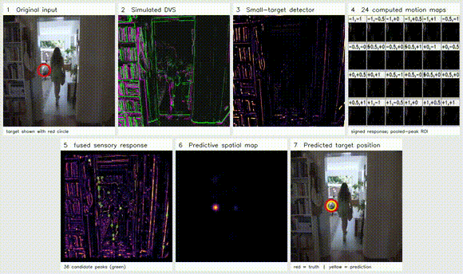

# Small-target motion detection (STMD) — 24 motion channels

A reproducible **intensity-frame** STMD-inspired experiment using an indoor video and a simulated dark moving dot. The model does **not** consume DVS events; the DVS-style panel in the video is a visualization only.

## Processing video



[Full 14.6-second MP4](media/stmd_actual_pipeline_1m_7mm.mp4) — 7 mm target at 1 m, moving background.

Panels: **Original input** (red circle marks the simulated target), **Simulated DVS**, **Small-target detector**, **24 motion maps**, **Fused sensory response**, **Predictive spatial map**, and **Predicted target position**. On the final panel, **red = ground truth**, **yellow = prediction**. The red circle is slightly larger, and yellow is drawn in front. Ground truth is never passed to the detector.

## Detection accuracy — without additional memory

These use the **raw pooled sensory peak**, without additional predictive spatial memory (the three 24-channel motion banks and local-flow branch remain). A prediction counts as correct when it is within **5°** of the true target direction. This is **forced-choice localization**, not a confidence-gated detection rate. Results average **two fixed trajectories** (seeds 173 and 281), 265 evaluated frames each per condition. The detector uses the same target-free calibration for both backgrounds.

### 7 mm dot (mosquito-sized simulation)

| Background | 50 cm | 1 m | 2 m | 3 m | 4 m |
|---|---:|---:|---:|---:|---:|
| Still background | 97.0% | 98.9% | 85.1% | 47.2% | 10.4% |
| Moving background | 92.6% | 89.2% | 53.2% | 11.3% | 2.1% |

### 20 mm dot (hornet-sized simulation)

| Background | 50 cm | 1 m | 2 m | 3 m | 4 m |
|---|---:|---:|---:|---:|---:|
| Still background | 42.8% | 94.3% | 98.7% | 98.7% | 96.6% |
| Moving background | 19.1% | 87.5% | 90.9% | 89.1% | 87.4% |

**Overall, localization is easier with a still background than a moving one**, although the size-selective detector does not necessarily favor the largest dot at the shortest distance. This is a synthetic test, not measured insect detection range.

The **target trajectory and image-plane speed stay fixed** across distances. Only the dot's projected diameter changes, with area integration and mild blur. The video source is 1920 × 1080, cropped/downsampled to 320 × 320; the assumed field of view is 84°. Still background repeats the first frame, while moving background replays the original footage. These are image-sequence controls, not calibrated camera speeds.

[Full results](results/summary.csv) · [Individual trials](results/all_trials.csv) · [Protocol](results/protocol.json)

## Run

```bash
pip install -r requirements.txt
python -m unittest discover -s tests -v
python src/benchmark_sizes.py
python src/render_process.py
```

The benchmark computes the raw STMD output; the demonstration additionally shows the model's predictive spatial map. The map is a separate visualization and **is not used for the accuracy tables above**.

## Scientific inspiration

- Wiederman, Shoemaker & O'Carroll (2013). [Correlation between OFF and ON channels underlies dark target selectivity in an insect visual system](https://doi.org/10.1523/JNEUROSCI.1277-13.2013).
- Wang, Peng & Yue (2020). [A Directionally Selective Small Target Motion Detecting Visual Neural Network in Cluttered Backgrounds](https://doi.org/10.1109/TCYB.2018.2869384).

This is a simplified STMD-inspired computational model, not an exact reproduction of either paper. Its target is an idealized black disk, not a rendered mosquito or hornet.
