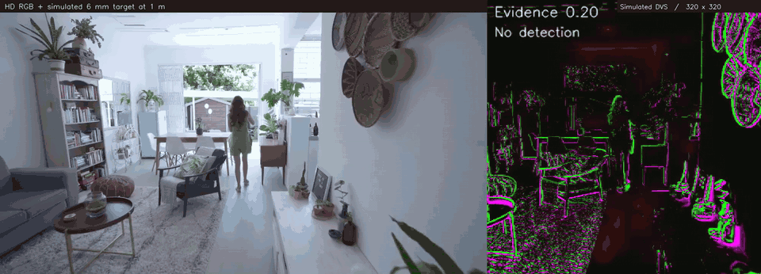

# Tuned small-target motion detector (STMD)

**A lightweight, insect-inspired vision demonstration for detecting tiny moving targets against a moving, cluttered background.**

The motivation is **PERCH**, a proposed flying microrobot that could use small-target motion detection to locate insect prey. This repository specifically demonstrates **the visual detection algorithm**, not insect recognition or successful capture by a flying robot.

## Demo — simulated 6 mm target at 1 m



[**Watch the 4-second HD MP4**](media/stmd_tuned_1m_HD_short.mp4) · [**Watch the full 20-second HD experiment**](media/stmd_tuned_1m_HD_20s.mp4) · [Still image](media/stmd_tuned_1m_HD_still.jpg)

- **Left:** the original 1920 × 1080 indoor footage, shown at **1280 × 720** with a black synthetic target added. The left image is **not enlarged from 320 × 320**.
- **Right:** a **320 × 320 frame-derived simulated DVS-style visualization**, scaled up for display only. Green marks brightness increases, magenta marks decreases. The yellow circle/arrow indicates the detector output; the **evidence** annotation is a relative detector score, **not a calibrated probability**.
- The **detector's actual input is 320 × 320 grayscale intensity frames**, not asynchronous DVS events. This is **not a GENX320 sensor recording** or a full physical event-camera simulator. The DVS-style view is generated **for visualization** using successive grayscale frames and log-intensity differences with thresholding: `ON = max(log(1+I_t) - log(1+I_{t-1}) - 0.045, 0)`, with a corresponding `OFF` term for decreasing brightness. An STMD activity heatmap and detection marker are overlaid.

The animated excerpt is 4 seconds of the original 25 fps sequence. The full 20 s video uses the 14.6 s source followed by 5.4 s **in reverse order**, preserving the original frame rate (this is not extra real footage). No ground-truth trajectory trace is drawn.

## Architecture


**[View larger PNG](media/architecture.png)** · [Editable figure source](docs/draw_architecture.py)

The simplified, **six-stage** pipeline reflects the included code:

1. **Retina / input:** grayscale 320 × 320 frames (center crop, following area downsampling).
2. **Egomotion compensation:** estimate global shift by *phase correlation*, align a slow-running background model and compute positive dark residuals (`predicted_background - current_frame`).
3. **Spatial small-target selectivity:** positive difference between narrow and broad Gaussian responses (σ = **0.55** and **3.0** detector pixels), inhibited by a *Gaussian-surround texture statistic* (surround σ = **3.0**).
4. **Two neural-evidence pathways:** a broad response and a pathway with additional local motion-density inhibition.
5. **Direction-tuned temporal facilitation:** 14 candidate 2D velocity shifts with leaky integration (`decay = 0.85` per frame).
6. **Readout:** maximum evidence across directions and the two pathways; detection when that pathway's normalized activity exceeds its global control-calibrated threshold. Report position, preferred direction and an uncalibrated evidence score.

**No multiple-target hypothesis bank is used here.** This is the original **tuned two-pathway model**, not the later competing-hypothesis version. It is an **STMD-inspired hybrid**, not a full retinal ON/OFF-correlator model or biologically exact neuron simulation. Read the [technical methods](docs/METHODS.md) for details.

## Evaluation — reproduced on original footage

| Distance to target | Apparent diameter at 320 px | Correct detections (frames 100–249) |
|:--|--:|--:|
| **50 cm** | **2.62 px** | **88.0%** |
| **1 m** | **1.31 px** | **76.7%** |
| **2 m** | **0.65 px** | **33.3%** |
| No-target control | — | **0.0% false detections** |

These values are **independently reproduced by rerunning this tuned implementation on the original video**, not results from the competing-hypothesis implementation. A detection is correct only when its global peak exceeds the preselected threshold and its position is within **8 pixels** of the synthetic target. The 0.0% no-target rate applies **only to frames 100–249** (the full 500-frame control has an **11.6%** detection rate). See [per-frame CSVs](results/) and [reproduced summary](results/reproduced_summary.json).

**Caveats:** This is one indoor scene, one target trajectory, and a synthetic black disk, not live mosquitoes. The target follows a smooth, fairly simple simulated path; results **cannot be generalized to erratic prey flight or real hardware**. The initial 100 frames of the dot-free video are used to set two scalar thresholds, and the evaluation interval is frames 100–249; this does not establish generalization to new environments. The detector processes grayscale intensity rather than physical DVS events.

### How a subpixel dot is simulated

The real indoor recording is resized using **`cv2.INTER_AREA`**, preserving relative area contributions during downsampling. For the model input, the 1920 × 1080 source is scaled to approximately **569 × 320**, then **center-cropped to 320 × 320** without changing the aspect ratio.

**After resizing**, a 6 mm black target is rendered into the 320 × 320 input, with apparent diameter estimated from an assumed **84° horizontal field of view**, using a **12× supersampled disk → `INTER_AREA` fractional pixel coverage → a small Gaussian σ = 0.42 px** → alpha composition. This lets a subpixel black object affect the intensity of one or more sensor pixels instead of disappearing. There is **no additional blur applied to the stimulus before detection**. The σ = 0.42 px is the tuned benchmark's original rendering parameter, retained so the results remain reproducible; changing it defines a different experiment.

The 84° field of view is an **assumption** rather than a measured intrinsic parameter of the source camera. These distances are simulated apparent angular sizes, not measured real-world detection distances.

## Install and run

Python **3.10+**, [FFmpeg](https://ffmpeg.org/) installed and on your `PATH` (for video generation):

```bash
python -m venv .venv
# Linux/macOS: source .venv/bin/activate
# Windows:    .venv\Scripts\activate
pip install -r requirements.txt
```

**Reproduce all three distances and the no-target control** (outputs written to `outputs/`):

```bash
python benchmark.py
```

Or select one distance:

```bash
python benchmark.py --distance 2m
```

To also regenerate legacy compact four-panel videos:

```bash
python benchmark.py --distance 1m --render
```

To regenerate the **high-definition 1 m two-panel demonstration and README GIF**:

```bash
python render_hd.py
```

For faster media generation (short clip and GIF only): `python render_hd.py --short-only`. Source footage is in [`data/`](data/). The source file is the **original**, not the compressed substitute that affected the earlier GitHub model's measurements.

Unit tests: `python -m unittest discover -s tests -v`.

## Repository structure

```text
README.md
stmd_model.py               # exact tuned detector + subpixel-dot renderer
benchmark.py                # calibrated 500-frame experiment, CSV and metrics
render_hd.py                # HD original + simulated DVS comparison media
requirements.txt
notebooks/STMD_tuned_demo.ipynb
docs/METHODS.md
docs/draw_architecture.py   # regenerates the single-row architecture
media/                      # README GIF, HD MP4s, diagram
results/                    # original reproduced frame-by-frame measurements
data/source_indoor_walking.mp4
```

## Scientific references

These papers provide the biological and computational inspiration. **The code does not implement their full published neural circuits.**

1. **Wiederman, Shoemaker & O'Carroll (2013)** — *Correlation between OFF and ON channels underlies dark target selectivity in an insect visual system*, *Journal of Neuroscience*, 33:13225–13232. [https://doi.org/10.1523/JNEUROSCI.1277-13.2013](https://doi.org/10.1523/JNEUROSCI.1277-13.2013)
2. **Wang, Peng & Yue (2020)** — *A Directionally Selective Small Target Motion Detecting Visual Neural Network in Cluttered Backgrounds*, *IEEE Transactions on Cybernetics*, 50:1541–1555. [https://doi.org/10.1109/TCYB.2018.2869384](https://doi.org/10.1109/TCYB.2018.2869384)
3. **Wang, Peng, Zheng & Yue (2020)** — *A Robust Visual System for Small Target Motion Detection Against Cluttered Moving Backgrounds*, *IEEE Transactions on Neural Networks and Learning Systems*, 31:839–853. [https://doi.org/10.1109/TNNLS.2019.2910418](https://doi.org/10.1109/TNNLS.2019.2910418)
4. **Wiederman, Fabian, Dunbier & O'Carroll (2017)** — *A predictive focus of gain modulation encodes target trajectories in insect vision*, *eLife*, 6:e26478. [https://doi.org/10.7554/eLife.26478](https://doi.org/10.7554/eLife.26478)

## Limitations and licensing

The design supports research into STMD-like small-target motion detection for future **PERCH** vision systems, but **does not demonstrate real event-camera input, mosquito identification, autonomous pursuit, or insect capture**. The 320 px simulated DVS rendering should not be interpreted as an optical/sensor-accurate GENX320 emulator.

Code is MIT licensed. The video and derived media may be subject to separate rights; check [`data/VIDEO_NOTICE.md`](data/VIDEO_NOTICE.md) before publishing the footage publicly. The code license does not automatically grant rights to any third-party recording.
