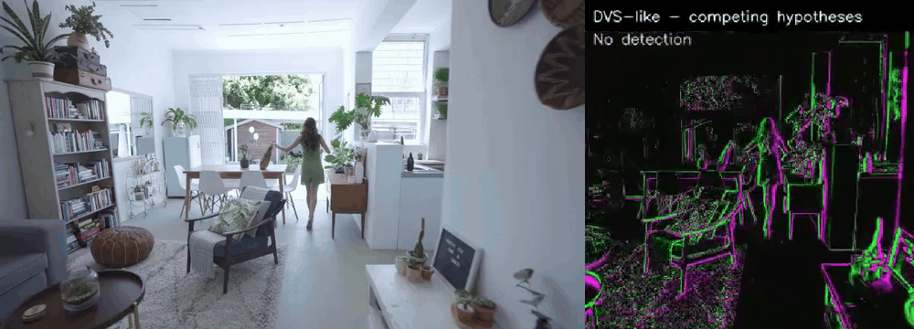
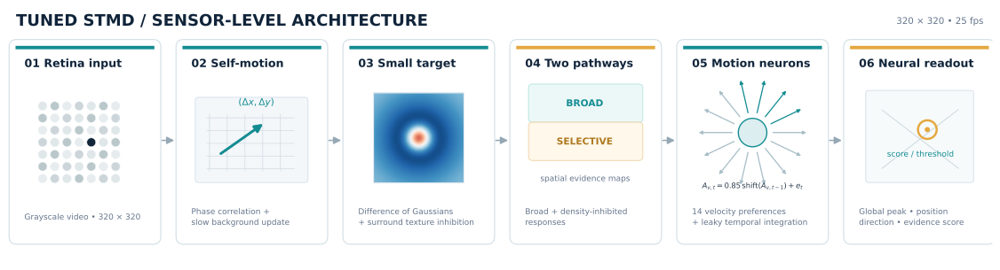
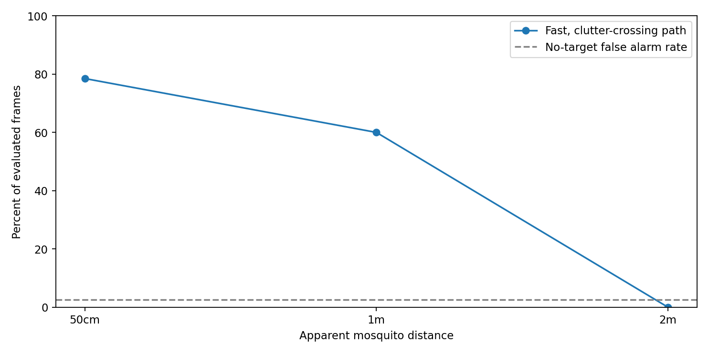

# Insect-inspired small-target motion detection (STMD)

**A reproducible demonstration of detecting tiny moving targets in a cluttered, moving indoor scene.**

This repository explores **Small Target Motion Detector (STMD)** principles from insect vision as an efficient way to detect moving objects only a few pixels—or less—across. One potential application is **PERCH**, a small flying robot concept that aims to visually detect and pursue insect prey. The purpose of this repository is to demonstrate the *perception algorithm*, not to claim an integrated autonomous robot or a field-validated mosquito detector.

## Demo: simulated mosquito at 1 metre



**Left:** high-resolution indoor RGB video (**1280 × 720**, downscaled directly from the original 1920 × 1080 footage, never enlarged from the 320-pixel crop) with an injected black dot representing a target of approximately **6 mm at 1 m** (about **1.31 pixels** in the detector's 320-pixel input). **Right:** the **320 × 320 simulated DVS-style visualization**, enlarged by nearest-neighbour scaling *for display only* (ON-like activity in green, OFF-like in magenta), with the detector's accepted estimate in yellow and other competing hypotheses in blue. The confidence shown in the right panel is an *uncalibrated evidence score*, not a probability of mosquito presence.

[Play the 4-second HD RGB + DVS MP4](media/stmd_1m_short_HD.mp4) · [Full 20-second, four-panel HD RGB + DVS demonstration](media/stmd_1m_four_panel_HD.mp4) · [HD still frame](media/stmd_1m_frame_HD.jpg)

The full demonstration also has a **no-target control** in the bottom row. The GIF is an illustrative excerpt from that full video; it is not a substitute for the quantitative evaluation below. **No green ground-truth trace** is added in these videos.

> **Sensor distinction:** The display is a simulation made from successive conventional video frames; it is **not data recorded by a Prophesee GENX320**. The detector itself processes greyscale video, not asynchronous DVS events. The **model input and simulated DVS raster** are **320 × 320**, comparable in pixel count to the GENX320. In the demo, only the **RGB panel** uses the high-resolution source. DVS output is resized to match its onscreen height; this adds no event-camera detail.

## Architecture



The diagram depicts the code's actual processing blocks. It is a **hybrid, biologically inspired model**, combining STMD-like motion-sensitive populations with standard computer-vision components:

1. **Retina-like preprocessing / dark target evidence:** local spatial contrast, narrow-versus-broad Gaussian filtering and dark motion residuals favour small moving objects.
2. **Background and self-motion handling:** global frame shift is estimated using phase correlation; a fourth parallel channel uses **Farneback optical flow** to align local image motion and identify unexplained dark residuals.
3. **Three STMD-like evidence populations:** a broad response, a dense-motion-inhibited response, and a texture-tolerant response. These integrate spatially and temporally over candidate motion directions.
4. **Competing predictions:** local evidence maxima can initiate up to **nine** target hypotheses, each with position, velocity, decaying evidence and a short hit/miss history. The bank starts **empty**—there is no initial target coordinate.
5. **Readout and confidence:** the leading supported hypothesis provides a location, motion direction and a multi-factor *heuristic confidence*; other hypotheses remain available and may take over if the leader loses support.

The hypotheses are **not** a trained deep neural network, and this code is **not** a full biophysical reconstruction of insect neurons. A concise signal-level explanation, equations and limitations are in [Methods](docs/METHODS.md). The editable [Graphviz source for the diagram](media/architecture.dot) is included.

## Results on one indoor test clip

| Condition | Projected target diameter | Correct localization, frames 100–364 |
|---|---:|---:|
| Mosquito-size target at **50 cm** | ~2.62 px | **78.5%** |
| Mosquito-size target at **1 m** | ~1.31 px | **60.0%** |
| Mosquito-size target at **2 m** | ~0.65 px | **0.0%** |
| **No target** control | — | **2.6% false-detection frames** |



A correct localization requires a committed detection within **8 pixels** of the injected target. The model does **not** receive target coordinates during inference; these coordinates are used only to score results afterward. Neural response scales were calibrated on a different interval of the **same no-target clip** (frames 25–99), so these results are **scene-specific**; they should not be interpreted as independent real-world generalization or proof of 2 m mosquito detection. The 1 m example is deliberately challenging and includes misses.

## Run locally

**Requirements:** Python 3.10+, `ffmpeg` for MP4 rendering, and the packages in `requirements.txt`.

```bash
python -m venv .venv
# Linux / macOS
source .venv/bin/activate
# Windows PowerShell: .venv\Scripts\Activate.ps1
pip install -r requirements.txt
```

Run the default **1 m** experiment on the included indoor clip:

```bash
python run_demo.py --distance 1m
```

Output is written to `outputs/`: side-by-side MP4, per-frame detections, and a metrics CSV. The **default is the original 365-frame source at native 25 fps (14.6 s), without slow motion or reversed footage**.

To run all three distances and recreate the longer 20-second convention from the earlier benchmark (forward footage followed by a reversed segment, at unchanged frame rate):

```bash
python run_demo.py --all --frames 500
```

To use another video:

```bash
python run_demo.py --input /path/to/indoor_video.mp4 --distance 1m
```

To run basic consistency tests:

```bash
python -m unittest discover -s tests -v
```

To regenerate the high-resolution repository demo after updating the model, first render the 320-pixel four-panel video (`python run_demo.py --distance 1m --frames 500 --out outputs/`), then use `make_hd_media.py` with that render placed at `media/stmd_1m_four_panel.mp4`. The high-resolution script overlays the known *synthetic* dot on the original HD footage only for visualization, while the detections continue to come from the unchanged 320-pixel model.

A short [Jupyter notebook](notebooks/STMD_demo.ipynb) introduces the experiment and plots its evaluation results. The original detailed per-frame results are in [`results/`](results/).

## Repository structure

```text
.
├── README.md                 # Overview, embedded demo and papers
├── run_demo.py              # Reproducible command-line entry point
├── stmd_model.py            # STMD-like spatial/temporal motion populations
├── multi_hypothesis.py      # Optical-flow channel and predictive hypothesis bank
├── render_and_report.py    # Original 20-second benchmark reproduction
├── make_hd_media.py        # Rebuild HD RGB + 320px DVS GitHub preview
├── docs/METHODS.md          # Methods, mathematics and limitations
├── media/
│   ├── stmd_1m_demo_HD.gif # Short, sharper RGB left / DVS right demo
│   ├── stmd_1m_short_HD.mp4
│   ├── stmd_1m_four_panel_HD.mp4
│   ├── stmd_1m_four_panel.mp4 # Legacy 320px panel render, input to HD rebuild
│   ├── architecture.svg
│   └── architecture.dot
├── data/                    # Example indoor source video and rights notice
├── results/                 # Evaluation tables for all three conditions
├── notebooks/STMD_demo.ipynb
└── tests/test_stmd.py
```

## Connection to insect vision and papers

Insect **small-target motion detector neurons** respond selectively to small moving features even against textured visual backgrounds. Work on the **elementary STMD (ESTMD)** model explains dark-target selectivity via interactions between OFF and ON signals; **direction-selective STMD** models explore spatial and temporal correlation; dragonfly recordings also demonstrate **predictive gain modulation** that enhances responses near expected target trajectories.

This repository is **inspired by** those findings, not an implementation of every proposed anatomical connection:

1. **Wiederman, Shoemaker & O'Carroll (2013)** — *Correlation between OFF and ON channels underlies dark target selectivity in an insect visual system.* *Journal of Neuroscience*, 33(32), 13225–13232. [DOI: 10.1523/JNEUROSCI.1277-13.2013](https://doi.org/10.1523/JNEUROSCI.1277-13.2013)
2. **Wang, Peng & Yue (2020; online 2018)** — *A Directionally Selective Small Target Motion Detecting Visual Neural Network in Cluttered Backgrounds.* *IEEE Transactions on Cybernetics*, 50(4), 1541–1555. [DOI: 10.1109/TCYB.2018.2869384](https://doi.org/10.1109/TCYB.2018.2869384)
3. **Wiederman, Fabian, Dunbier & O'Carroll (2017)** — *A predictive focus of gain modulation encodes target trajectories in insect vision.* *eLife*, 6:e26478. [DOI: 10.7554/eLife.26478](https://doi.org/10.7554/eLife.26478)

## Scope and limitations

- This is a **research demonstration**, not validated insect identification, autonomous interception, or real-hardware flight control.
- The right panel is **frame-derived DVS-style visualization**, not a true simulated event-camera sensor model with asynchronous events and timestamps. The current detection pipeline uses ordinary intensity frames.
- Confidence is a **heuristic evidence signal**, not a calibrated detection probability.
- The example target is a **black disk with projected apparent size**; actual mosquito wings, motion blur, exposure, and contrast can produce different visual signatures.
- Performance falls markedly at **2 m** and on some textured trajectories. See [Methods](docs/METHODS.md) and [`results/`](results/) for details.
- The local optic-flow channel and hypothesis association are standard computer vision / tracking components rather than experimentally confirmed neural circuits.

## Licensing and media

Code is provided under [MIT](LICENSE). **The example footage and derived demonstration clips are separate media assets:** before publishing to a public GitHub repository, confirm that you hold the appropriate rights to distribute them. The example footage here was provided for this demonstration, but its original licensing provenance has **not been independently established**. See [video notice](data/VIDEO_NOTICE.md). The MIT license must not be assumed to cover third-party footage.
