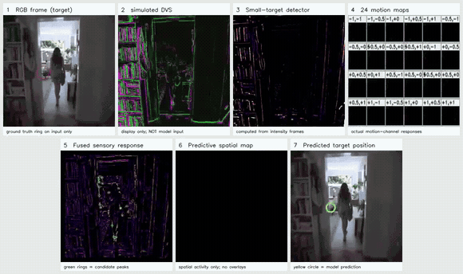
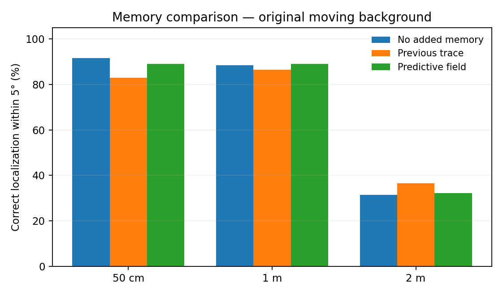
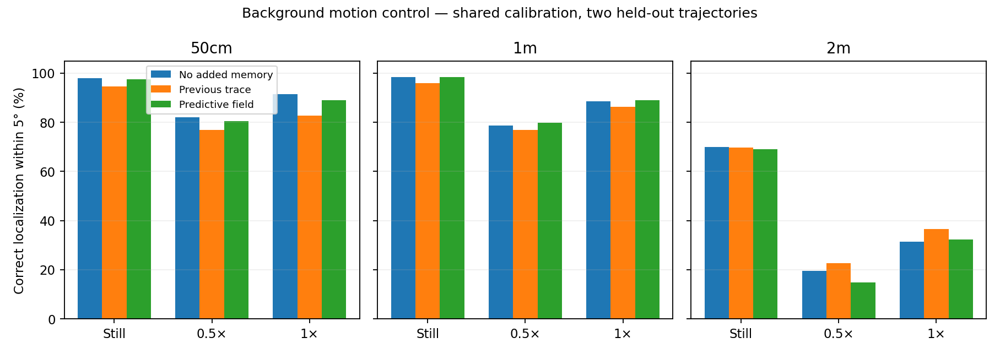

# Small-target motion detection — 24 motion channels and predictive spatial memory

An STMD-inspired detector for localizing a tiny moving dark target against a cluttered background. The experiment uses **real indoor video with a simulated black target**; the algorithm operates on conventional intensity frames, not real DVS events.

## Full-length processing animation (1 m)



[Watch the sharper 14.6-second MP4](media/stmd_actual_pipeline_1m.mp4) · [One full-resolution frame](media/pipeline_frame_100.png)

**Red thin circle = ground truth, visible only on input. Yellow circle = detector output, visible only on the final panel.** The target never enters the detector as coordinates; ground truth is used only for the input annotation and offline scoring.

### What each animated panel actually contains

1. **RGB intensity frame:** source downsampled to 320 × 320, with the injected black target.
2. **Simulated DVS-style view:** thresholded differences of successive *log-intensity frames*, colored by ON/OFF polarity. **Display only — not fed to the model.** This is not asynchronous event-camera output.
3. **Small-target detector:** a positive narrow-minus-wide Gaussian spatial response to the image's background-compensated dark residual, further weighted by local texture inhibition. **Computed from intensity frames, not panel 2.**
4. **24 real motion-channel maps:** actual recurrent arrays from **one** STMD bank. The display shows the **signed contrast `A[k] - mean_k(A)`**, zoomed to a 72 × 72 pixel region centred on the *strongest pooled sensory peak* (not on ground truth). It uses a **shared contrast scale**, making weak directional differences visible. This contrast display is diagnostic; the model pools the **original, unmodified maps**.
5. **Fused sensory response (previously “sensory max + peaks”):** the three STMD banks and the local optical-flow residual each produce a full spatial response map. After calibration by target-free response scales, the program takes the **pixelwise maximum** of the four pathway maps. Green rings identify up to 40 well-separated local maxima in that fused map. These are **candidate locations**, not target ground truth or the final prediction. The former separate “3 banks + local flow” visualization has been removed; the four pathways still run inside the unchanged detector.
6. **Predictive spatial map:** the computed spatial activity heatmap only, without trajectory traces, circles, velocity arrows, or prediction markers drawn on top. The displayed array is the model's *prior* activity field (before the current-frame update); its spatial structure may itself reflect accumulated history. This is not a separately plotted tracking trace.
7. **Predicted target position:** RGB frame with the **model's yellow circular position estimate only**, without a white center dot or any ground-truth overlay.

**Why the old panel 5 existed:** it displayed four internal sensory pathways, not an additional separate stage: three distinct STMD banks (each has 24 recurrent motion-channel maps and differently tuned clutter suppression), and a separate local-flow residual pathway. Its purpose was to compare what those four branches responded to. The next panel combines them, which is why you can remove the diagnostic without removing the computation.

**Note:** This is the original **intensity-frame** detector. The simulated DVS panel is for visualization only and does not feed the STMD model. These revisions affect only the video presentation and file encoding; the computational algorithm and benchmark data are unchanged.

## Architecture in brief

Three independent STMD banks maintain 24 spatial motion-activity maps each (72 maps total), using a 5 × 5 velocity grid excluding (0, 0). Each channel integrates its previous shifted activity and present sensory evidence:

`A_k(t) = 0.85 · shift(A_k(t−1), velocity[k]) + E(t)`

The current model **does not implement the original ESTMD's delayed OFF–ON correlator**, and the maps may share substantial common activity, because each receives the same new evidence. The separately shown signed contrasts help inspect actual directional selectivity; they are not invented neuron responses.

The predictive memory replaces the former inhibitory-ring heuristic. It translates previous 2D activity using a velocity inferred from the last associated output positions, smooths it slightly, and increases the scores of current candidates supported by the shifted map:

`score(candidate) = sensory_strength × (1 + gain × predicted_map[candidate])`

The memory is updated with Gaussian bumps from current candidates, with bounded feedback and spatial normalization. It is a **heuristic attractor-like predictive activity field**, *not* a validated biological continuous-attractor network or a probabilistic target tracker. It cannot guarantee that random scene features won't be reinforced.

## Experimental results

**Metric:** for each frame, a position estimate is correct if its 3D camera ray lies within **5°** of the synthetic target's true ray; unreturned positions count as wrong. The assumed square sensor's field of view is **84°**, not independently calibrated. Two held-out randomized trajectories (seeds 173 and 281), each covering the whole room view, supply 530 evaluated frames per distance and condition (frames 100–364).

### Predictive memory vs no added memory

| Model, original moving background | 50 cm | 1 m | 2 m |
|---|---:|---:|---:|
| No additional memory | **91.5%** | 88.5% | 31.5% |
| Previous spatial trace with annular inhibition | 82.8% | 86.4% | **36.6%** |
| **Normalized predictive field (this repository)** | 89.1% | **89.1%** | 32.3% |



The predictive field **does not consistently beat the baseline**. It modestly improves 1 m and 2 m over raw peak selection but loses to raw peaks at 50 cm and to the previous annular trace at 2 m. Thus these experiments establish the implementation and its limitations, *not* a validated improvement in all conditions.

### Background motion control — corrected calibration

The insect path and speed remain **identical**, but the source background is replayed as a frozen frame, at 0.5×, or at its original speed. All conditions now use the **same calibration, measured on the target-free original moving footage**. The previous frozen-background result was invalid because calibrating on a constant image created near-zero response scales.

| Background, predictive field | 50 cm | 1 m | 2 m |
|---|---:|---:|---:|
| **Frozen** | **97.5%** | **98.3%** | **69.1%** |
| Slow (0.5×) | 80.4% | 79.8% | 14.7% |
| Normal (1×) | 89.1% | 89.1% | 32.3% |



Full per-condition results: [`results/grid24_predictive_camera_control.csv`](results/grid24_predictive_camera_control.csv). This control measures background replay speed, **not a calibrated camera translation in m/s**.

### Why 24 rather than 9?

The previous matched-bank comparison selected a **5 × 5 grid excluding (0,0): 24 channels** over a **3 × 3 grid excluding (0,0): 8 actual moving channels**. With the **previous annular-memory readout**, 24 scored 82.8% / 86.4% / 36.6% versus 80.6% / 80.9% / 30.0% (50 cm / 1 m / 2 m). The selection therefore preceded the new predictive-field experiment. See [`results/motion_bank_9_vs_24.csv`](results/motion_bank_9_vs_24.csv).

## Run locally

Requires Python, NumPy, OpenCV, SciPy, Pandas and Matplotlib. FFmpeg generates a compact preview GIF from the rendered MP4.

```bash
pip install -r requirements.txt
python -m unittest discover -s tests -v

# New 24-channel detector and predictive spatial field
python src/predictive_demo.py --seed 173 --distance 1 --n-frames 365

# Controlled camera-speed comparison (computationally expensive)
python src/retest_predictive.py

# Regenerate the full 365-frame process MP4
python src/render_process.py

# Or re-compose the supplied original eight-panel movie without re-running the detector:
python src/relabel_existing_video.py

# Compress video and preview for sharing (requires FFmpeg)
ffmpeg -i media/stmd_actual_pipeline_1m.mp4 -c:v libx264 -crf 27 -preset medium -pix_fmt yuv420p media/stmd_compact.mp4
```

The 1920 × 1080 source is resized with `cv2.INTER_AREA` to a **320-pixel height**, then the central 320 × 320 square is cropped. The synthetic 6 mm dark disk is inserted **after downsampling**, using 12× subpixel supersampling, pixel-area integration, and a small σ = 0.42 px softening of alpha coverage. At 50 cm, 1 m and 2 m, its assumed apparent diameters are approximately **2.62, 1.31 and 0.65 pixels**. This is a simulator, not a validated optical or event-camera model.

## Papers and camera-input distinction

The original STMD/ESTMD literature models biological **photoreceptor luminance**, ON/OFF and spatial/temporal filtering using image sequences, **not a physical event camera stream**:

- Wiederman, Shoemaker & O'Carroll (2013), [Correlation between OFF and ON channels underlies dark target selectivity in an insect visual system](https://doi.org/10.1523/JNEUROSCI.1277-13.2013).
- Wang, Peng & Yue (2020), [A Directionally Selective Small Target Motion Detecting Visual Neural Network in Cluttered Backgrounds](https://doi.org/10.1109/TCYB.2018.2869384).
- Wang, Peng, Zheng & Yue (2020), [A Robust Visual System for Small Target Motion Detection Against Cluttered Moving Backgrounds](https://doi.org/10.1109/TNNLS.2019.2910418).
- Gallego et al. (2022), [Event-Based Vision: A Survey](https://doi.org/10.1109/TPAMI.2020.3008413) — how **real DVS** sensors emit asynchronous brightness-change events, requiring a distinct input-processing implementation.

The DVS panel in this repository is a **visualization**. Converting the detector to consume actual GENX320 events requires an event-based ON/OFF representation and revalidation; this has **not** been demonstrated here.

## Application: PERCH

Small-target detection could serve as the visual front end for **PERCH**, a proposed insect-inspired microrobot for detecting and capturing flying pests. These are simulated detections using synthetic targets and conventional footage, **not real drone or event-camera performance**. Verify footage redistribution rights before publicly releasing the original indoor video.

### Compact packaging

The supplied MP4 is H.264 encoded, and the GIF is a lower-resolution/lower-frame-rate preview. The 1920×1080 source video, original eight-panel diagnostic video, model source, test suite, and result files remain in the archive. The **spatial-map panel has no added trajectory or predicted-position overlays**; the model itself is unchanged.
